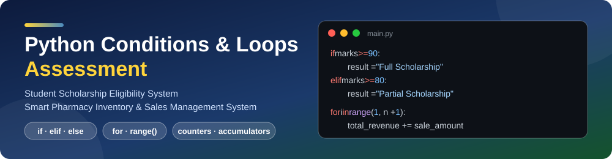
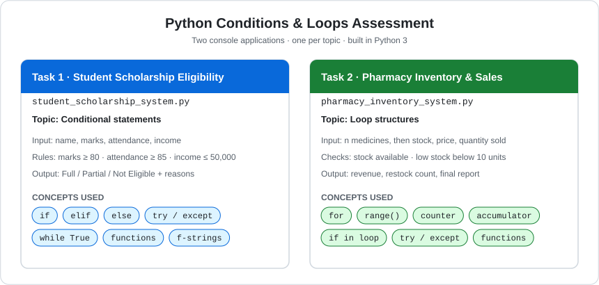
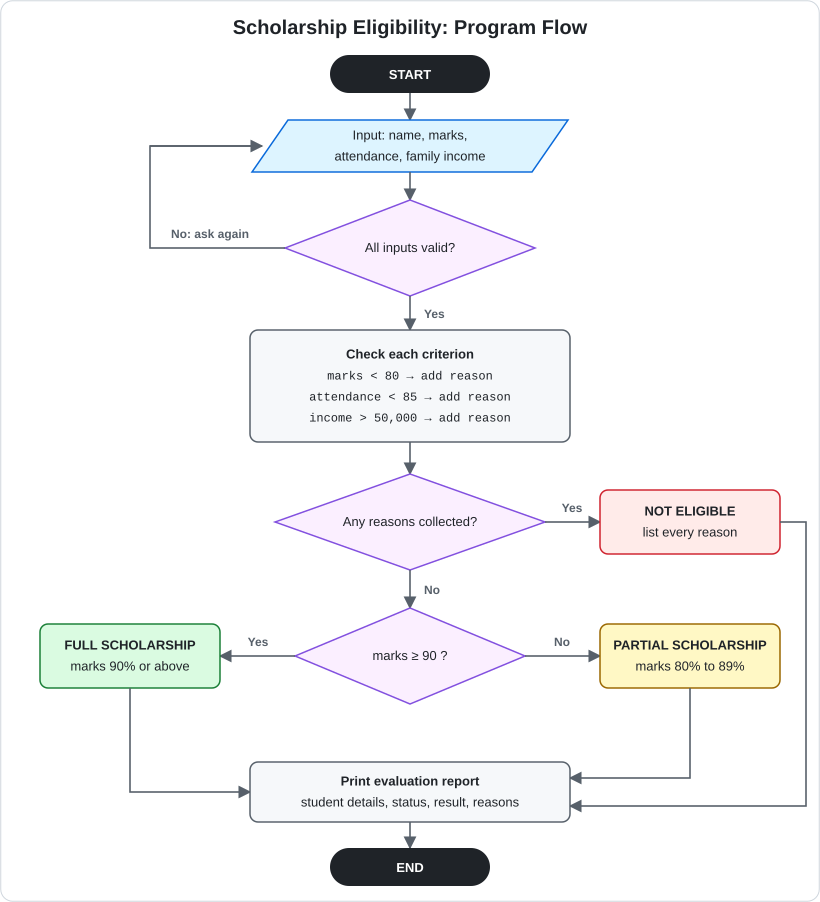
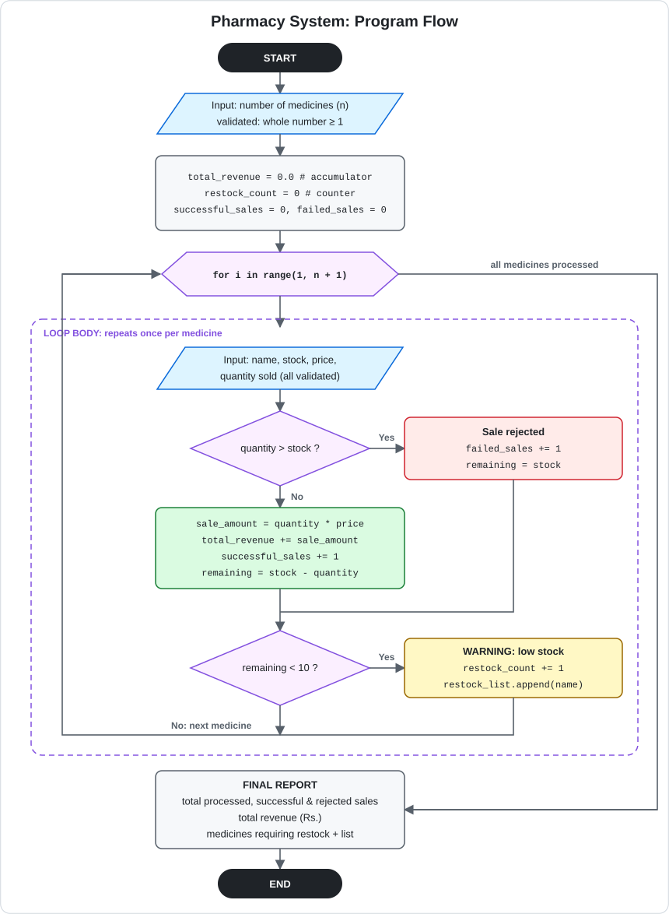
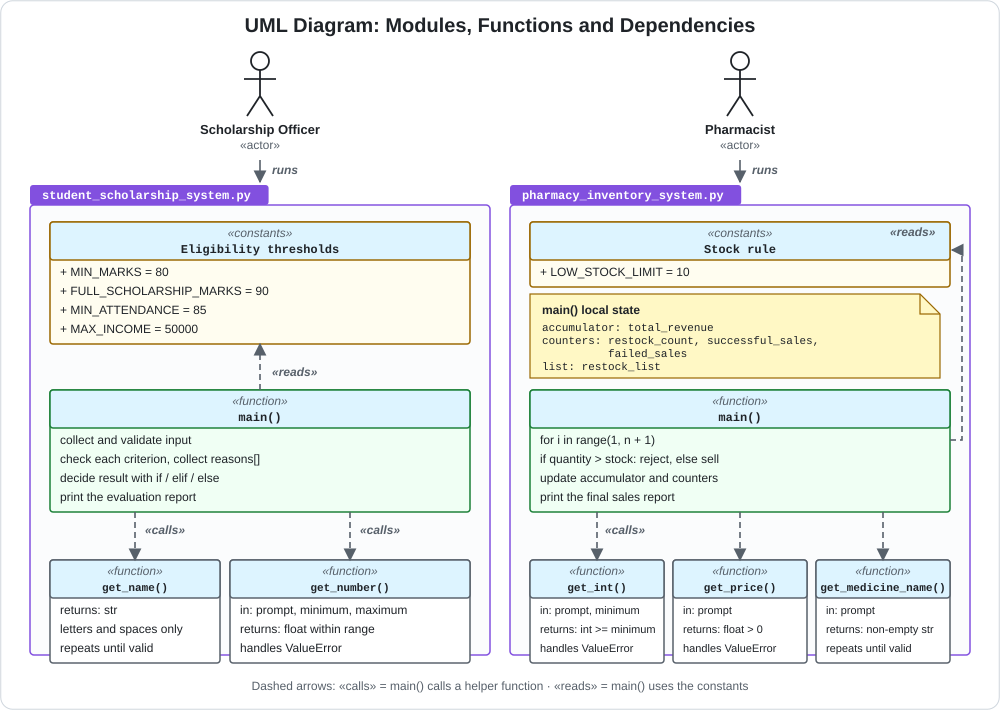

<p align="center">
  
</p>

# Python Conditions & Loops Assessment

## 1. Project Overview
This repository contains two separate console-based Python applications built for a programming assessment. Each one solves a realistic business problem while demonstrating a core Python topic.

| Application | File | Topic |
|-------------|------|-------|
| Student Scholarship Eligibility System | `student_scholarship_system.py` | Conditional statements (`if`, `elif`, `else`) |
| Smart Pharmacy Inventory & Sales Management System | `pharmacy_inventory_system.py` | Loop structures (`for`, `range()`, counters, accumulators) |



## 2. Folder Structure
```
python-conditions-loops-assessment/
├── student_scholarship_system.py
├── pharmacy_inventory_system.py
├── README.md
└── assets/                  (images used in this README)
    ├── banner.svg
    ├── overview.svg
    ├── scholarship_flow.svg
    ├── pharmacy_flow.svg
    └── uml_diagram.svg
```

---

## 3. Application 1: Student Scholarship Eligibility System

### Summary of Topic and Code
**Topic:** Conditional statements. The program evaluates a student against three criteria and uses `if` / `elif` / `else` to decide the scholarship category.

**Eligibility criteria (all must be met):**
- Academic marks of at least 80%
- Attendance of at least 85%
- Monthly family income of Rs. 50,000 or less

**Scholarship result:**
- Marks 90% or above: **Full Scholarship**
- Marks 80% to below 90%: **Partial Scholarship**
- Any criterion not met: **Not Eligible**, with every reason listed

### Program Flow


### Code Methods Description
| Method / Section | Purpose |
|------------------|---------|
| Constants (`MIN_MARKS`, `FULL_SCHOLARSHIP_MARKS`, `MIN_ATTENDANCE`, `MAX_INCOME`) | Store the eligibility limits in one place so they are easy to change |
| `get_name()` | Asks for the student name and repeats until a valid name is entered |
| `get_number(prompt, minimum, maximum)` | Asks for a numeric value and repeats until it is valid and in range |
| `main()` | Collects input, checks each criterion, collects failure reasons, decides the result, prints the report |

### Input Validation
- **Name:** cannot be empty; letters and spaces only.
- **Marks and attendance:** must be numbers between 0 and 100.
- **Income:** must be a number that is not negative.
- Text instead of numbers is handled with `try` / `except ValueError`.
- Invalid values are rejected and the user is asked again.

### Expected Results
- All three criteria met and marks >= 90: `ELIGIBLE`, Full Scholarship.
- All three criteria met and marks 80 to below 90: `ELIGIBLE`, Partial Scholarship.
- One or more criteria failed: `NOT ELIGIBLE`, with each reason printed.
- A complete evaluation report is always displayed.

---

## 4. Application 2: Smart Pharmacy Inventory & Sales Management System

### Summary of Topic and Code
**Topic:** Loop structures. The program uses a `for` loop with `range()` to process each medicine, with conditions inside the loop, a **counter** for restocking and an **accumulator** for total revenue.

**For each medicine it:**
1. Collects name, available stock, price per unit and quantity sold.
2. Checks whether the quantity sold is available in stock.
3. Calculates the sales amount and the remaining stock for successful sales.
4. Shows a low-stock warning if remaining stock is below 10 units.
5. Updates the revenue accumulator and the restock counter.

### Program Flow


### Code Methods Description
| Method / Section | Purpose |
|------------------|---------|
| `LOW_STOCK_LIMIT` | Constant for the low-stock threshold (10 units) |
| `get_int(prompt, minimum)` | Asks for a whole number >= minimum and repeats until valid |
| `get_price(prompt)` | Asks for a price greater than zero and repeats until valid |
| `get_medicine_name(prompt)` | Asks for a non-empty medicine name |
| `main()` | Runs the `for` loop, applies stock checks, updates counters and accumulators, prints the final report |

**Variables used for tracking:**
- `total_revenue`: accumulator for money earned
- `restock_count`: counter for medicines needing restock
- `successful_sales` / `failed_sales`: counters for accepted and rejected sales
- `restock_list`: names of medicines to restock

### Input Validation
- **Number of medicines:** whole number, at least 1.
- **Medicine name:** cannot be empty.
- **Available stock and quantity sold:** whole numbers, 0 or more.
- **Price per unit:** number greater than 0.
- Text instead of numbers is handled with `try` / `except ValueError`.
- A sale is rejected if the quantity sold is more than the available stock.

### Expected Results
- Enough stock: sale amount (`quantity x price`) and remaining stock are shown.
- Not enough stock: the sale is rejected and revenue is not changed.
- Remaining stock below 10: a low-stock warning is shown and the medicine is counted for restocking.
- Final report: total medicines processed, successful and rejected sales, total revenue, medicines requiring restocking and the restock list.

---

## 5. UML Diagram
Both programs are procedural, so the UML diagram shows each file as a module (package) with its constants, `main()` function and helper functions. Dashed arrows show which function calls which, and which constants `main()` reads.



---

## 6. Python Concepts and Techniques Used
- Variables and constants
- `input()` and `print()` with f-string formatting
- Arithmetic operators (`*`, `-`, `+=`)
- Comparison and logical operators (`<`, `>`, `>=`, `and`, `or`, `not`)
- Conditional statements: `if`, `elif`, `else`
- `for` loop with `range()`
- `while True` loops for input validation
- Exception handling with `try` / `except ValueError`
- Counters and accumulators
- Functions to reuse validation code
- Lists and string methods (`strip()`, `isalpha()`, `replace()`, `join()`)
- Comments and meaningful variable names

---

## 7. How to Run

### Requirements
- Python 3.8 or later

### Steps
1. Clone the repository:
   ```bash
   git clone https://github.com/hiraaslam-data/python-conditions-loops-assessment.git
   cd python-conditions-loops-assessment
   ```
2. Run the scholarship program:
   ```bash
   python student_scholarship_system.py
   ```
3. Run the pharmacy program:
   ```bash
   python pharmacy_inventory_system.py
   ```

On some systems use `python3` or `py` instead of `python`. You can also open a file in VS Code and click **Run**.

---

## 8. Sample Execution

### Task 1: Student Scholarship Eligibility System

**Example 1: Full Scholarship**
```
==================================================
   STUDENT SCHOLARSHIP ELIGIBILITY SYSTEM
==================================================
Enter student name: Ayesha Khan
Enter academic marks (%): 92
Enter attendance percentage (%): 90
Enter monthly family income (Rs.): 40000

==================================================
        SCHOLARSHIP EVALUATION REPORT
==================================================
Student Name      : Ayesha Khan
Academic Marks    : 92.00%  (min 80%)
Attendance        : 90.00%  (min 85%)
Monthly Income    : Rs. 40,000.00  (max Rs. 50,000)
--------------------------------------------------
Eligibility       : ELIGIBLE
Result            : Full Scholarship
==================================================
```

**Example 2: Not Eligible (multiple reasons)**
```
Enter student name: Ali Raza
Enter academic marks (%): 75
Enter attendance percentage (%): 85
Enter monthly family income (Rs.): 60000

==================================================
        SCHOLARSHIP EVALUATION REPORT
==================================================
Student Name      : Ali Raza
Academic Marks    : 75.00%  (min 80%)
Attendance        : 85.00%  (min 85%)
Monthly Income    : Rs. 60,000.00  (max Rs. 50,000)
--------------------------------------------------
Eligibility       : NOT ELIGIBLE
Result            : Not Eligible
Reason(s):
  - Marks are below the required 80%.
  - Monthly family income exceeds Rs. 50,000.
==================================================
```

### Task 2: Smart Pharmacy Inventory & Sales Management System
```
=======================================================
   SMART PHARMACY INVENTORY & SALES MANAGEMENT
=======================================================
How many different medicines to process? 3

--- Medicine 1 of 3 ---
Medicine name: Panadol
Available stock: 50
Price per unit (Rs.): 20
Quantity sold: 45
Sale amount     : Rs. 900.00
Remaining stock : 5
WARNING: Low stock for Panadol (5 left)!

--- Medicine 2 of 3 ---
Medicine name: Brufen
Available stock: 30
Price per unit (Rs.): 15
Quantity sold: 40
Sale rejected: only 30 unit(s) of Brufen in stock.

--- Medicine 3 of 3 ---
Medicine name: Disprin
Available stock: 12
Price per unit (Rs.): 5
Quantity sold: 2
Sale amount     : Rs. 10.00
Remaining stock : 10

=======================================================
                 FINAL SALES REPORT
=======================================================
Total medicines processed      : 3
Successful sales               : 2
Rejected sales (low stock)     : 1
Total revenue                  : Rs. 910.00
Medicines requiring restocking : 1
Restock list                   : Panadol
=======================================================
```

---

## 9. Test Cases

### Task 1: Scholarship System
| # | Scenario | Name | Marks | Attendance | Income (Rs.) | Expected Result |
|---|----------|------|-------|------------|--------------|-----------------|
| 1 | Full scholarship | Ayesha | 92 | 90 | 40,000 | Eligible: Full Scholarship |
| 2 | Partial scholarship | Sara | 85 | 88 | 50,000 | Eligible: Partial Scholarship |
| 3 | Boundary: marks = 80 | Bilal | 80 | 85 | 50,000 | Eligible: Partial Scholarship |
| 4 | Boundary: marks = 90 | Zain | 90 | 85 | 50,000 | Eligible: Full Scholarship |
| 5 | Marks too low | Hina | 79.9 | 90 | 30,000 | Not Eligible: marks below 80% |
| 6 | Attendance too low | Noor | 85 | 84 | 30,000 | Not Eligible: attendance below 85% |
| 7 | Income too high | Omar | 85 | 90 | 50,001 | Not Eligible: income exceeds Rs. 50,000 |
| 8 | Multiple failures | Ali | 75 | 85 | 60,000 | Not Eligible: marks and income reasons |
| 9 | Empty name or name with digits (`Ali123`) | - | - | - | - | Error message, asks again |
| 10 | Text instead of number (`abc`) | - | abc | - | - | "Invalid input", asks again |
| 11 | Marks out of range (`105`) | - | 105 | - | - | "Value must be between 0 and 100", asks again |
| 12 | Negative income (`-5`) | - | - | - | -5 | "Value must be 0 or more", asks again |

### Task 2: Pharmacy System
| # | Scenario | Stock | Price (Rs.) | Qty Sold | Expected Result |
|---|----------|-------|-------------|----------|-----------------|
| 1 | Normal sale | 50 | 20 | 10 | Amount Rs. 200.00, remaining 40, no warning |
| 2 | Quantity exceeds stock | 30 | 15 | 40 | Sale rejected, revenue unchanged |
| 3 | Remaining stock below 10 | 12 | 5 | 3 | Amount Rs. 15.00, remaining 9, low-stock warning |
| 4 | Remaining stock exactly 10 | 12 | 5 | 2 | Remaining 10, no warning |
| 5 | Zero quantity sold | 20 | 5 | 0 | Amount Rs. 0.00, remaining 20 |
| 6 | Multiple medicines (3) | mixed | mixed | mixed | Revenue Rs. 910.00, 2 successful, 1 rejected, 1 to restock |
| 7 | Number of medicines = 0 | - | - | - | "Value must be 1 or more", asks again |
| 8 | Text instead of number | abc | - | - | "Invalid input", asks again |
| 9 | Negative stock | -5 | - | - | "Value must be 0 or more", asks again |
| 10 | Zero price | - | 0 | - | "Price must be greater than 0", asks again |
| 11 | Empty medicine name | - | - | - | "Medicine name cannot be empty", asks again |

---

## Author
**Hira Aslam**
GitHub: [hiraaslam-data](https://github.com/hiraaslam-data)
